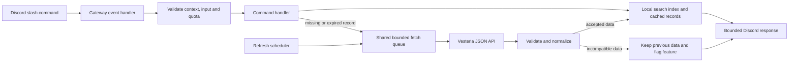

# Vesterian Discord app design

Proposed on 15 November 2026. This document is the target design. The first functional implementation is now described in [Commands and interaction walkthrough](commands.md), including its implemented controls and remaining gaps. The [policy example](../config/bot-policy.example.json) still records proposed defaults; the runtime does not load this file.

The design assumes an initial server-installed app, a single continuously running process, slash commands, and a local database/cache. Hosting and implementation language remain open. Evidence about Vesteria comes from the [verified route map](vesteria-route-map.md) and [saved response checks](../data/vesteria/endpoint-checks.json).

## 1. Commands and user experience

Start with ten commands. Keep related information inside views and buttons so users can discover features without remembering many commands. The examples below use Discord's `option:value` notation; bracketed options are optional.

| Command | What it answers | Data and behavior |
| --- | --- | --- |
| `/search query:... [type:...]` | Find an unfamiliar name | Search the local catalog; categorize items, abilities, monsters, maps, and updates. Show exact variants separately. A submitted search may use one bounded global-search fallback; autocomplete never does. |
| `/item name:... [view:overview/sources/crafting]` | Stats, requirements, how to obtain, recipes | Exact item JSON; `metadata`, `behaviorSummary`, `obtainedFrom`, `craftingRecipes`, `reforgeRecipes`, `usedInRecipes`. Include granted abilities and variant picker. |
| `/ability name:... [view:overview/ranks]` | Skill behavior, requirements, and rank progression | Book context plus exact ability/variant JSON; preserve separate upgrade paths. Start with rank tables rather than pretending every skill has one linear rank. |
| `/monster name:... [view:overview/drops/locations]` | Combat stats, loot, and known spawn areas | Exact encounter JSON; `combatStats`, `drops`, `spawnLocations`. Display drop conditions and quantity separately from chance. |
| `/map name:... [view:overview/monsters/npcs/exits]` | What is in a location | Map detail and supplied image; label unavailable destination links. NPC names and shop labels are available, but full quest logic is not established. |
| `/price item:... [view:summary/history]` | Recent market transactions and history | Item market JSON and history. Separate observed selling prices from asking prices, and show the source timestamp/window. Do not imply the bot can buy or sell. |
| `/codes [show:active/all]` | Codes and their requirements/rewards | Active and expired arrays; check expiry against the current time before showing an active code. |
| `/updates [version:...]` | Latest release or a selected release | Version index and its returned detail URL. Keep release-wide notes alongside asset changes. |
| `/help [command:...]` | Usage and examples | Local text; no upstream request. |
| `/status` | Whether answers are current | Last successful source check, catalog build time, and unavailable features. No hostnames, stack traces, tokens, or internal configuration. |

Suggested response: exact title and variant, a few relevant fields, source link, optional thumbnail, and page controls. Cache source records independently from user-specific presentation.

Default replies are private to the requester. Data commands can accept `public:true` for a deliberate channel-visible result. Search choices, help, and status stay private. Rate-limit and validation errors detected before replying are private; a failure after a public deferral updates that public reply with a short generic message.

Autocomplete searches a bounded local index and returns at most 25 choices. Its values are internal entry identifiers, which the server validates again; Discord permits manually supplied values even with autocomplete. Ambiguous free text produces a selector, not an arbitrary first match. [Discord command options](https://docs.discord.com/developers/interactions/application-commands)

Ordinary commands should reply or defer within a one-second internal target. Discord requires an initial response within three seconds, and continuation tokens last fifteen minutes. Autocomplete gets an immediate choices response and does not enter the deferred-work path. [Discord interaction responses](https://docs.discord.com/developers/interactions/receiving-and-responding)

Use ten rows per list page. Pagination and variant selection edit the same result, and only the invoking user may operate those controls. Controls expire after ten minutes. Apply mention suppression to initial replies, followups, and edits. Keep embeds within Discord's individual field and combined character limits. [Discord message formatting](https://docs.discord.com/developers/resources/message#embed-limits)

### Commands to add after the foundation works

| Feature | Scope and dependency |
| --- | --- |
| `/compare first:... second:...` | Comparable item stats only; retain units, tier, requirements, and differing conditions. Do not invent a universal best-item score. |
| `/where item:...`, `/craft item:...`, `/drops monster:...` | Shortcuts to existing views, sharing their handlers and caches. Expand multi-hop location lookup only within the fetch budget. |
| `/pvp [category:...] [sort:...]` | Badlands dashboard with its sample threshold; an unranked or insufficient-sample row is not zero performance. |
| `/watch updates channel:...`, `/watch stop` | Optional server announcements. Requires explicit server-admin configuration, per-server storage, delivery deduplication, and a separate bounded delivery queue. Disabled by default. |
| `/settings [channel:...]` | Server-specific command availability. Require Manage Server at execution time, including button callbacks. Changes affect only that server. |

Start with game data. Guides, videos, and guilds are mapped but add little to the first lookup release. Full player inventories, live combat simulation, exhaustive quests, and optimal travel paths are not established by the mapped API.

## 2. Architecture and website changes

Use a dedicated Vesteria adapter so Discord handlers consume our own small, versioned data models. For example, normalize search `url` or `path` into `pageUrl`, and preserve fractional market averages. Those two differences already appeared in the discovery run.

A persistent local store such as SQLite can hold accepted catalog generations, normalized records, endpoint check times, and future server settings. Keep a fast in-memory name index and bounded detail cache. A single process can keep quota counters and in-progress request tracking in memory. Before adding replicas, move quotas, fetch coordination, and scheduler leadership into a shared atomic store; Redis is one possible implementation.

### Refresh policy

These intervals are proposed application settings, not a published Vesteria quota or freshness guarantee. The source's cache directives can require stricter behavior, such as revalidation or not storing a response.

| Data | Refresh/check strategy | On failure |
| --- | --- | --- |
| Catalog and search index | Conditional GET every 15 minutes, with 10% scheduling jitter | Retain the last accepted generation; label unverified data. Stop serving current-stat answers after 7 days without validation. |
| Item/ability/monster/map details | Fetch on demand; recheck after 6 hours or catalog generation change | Serve a previously valid record, with its check time, within the 7-day limit. A never-fetched variant has no resolved fallback. |
| Codes | Check every 15 minutes | Do not claim an unverified code is active. Within 1 hour, show it as last seen and remove codes with known past expiry; after that, link to the source only. |
| Release list | Check every 15 minutes; fetch selected release on demand | Show cached notes with their dates and an outdated-check label, within the static-data limit. |
| 24-hour market summary | Cache for 15 minutes; refresh on demand | Display a timestamped cached result for at most 1 hour without validation. Then report unavailable. |
| Price history; future PvP view | Cache for 1 hour | Show explicitly dated historical data for at most 6 hours without validation. |

Keep `sourceUpdatedAt`/`builtAt`, `fetchedAt`, and `lastValidatedAt` separate. A successful 304 updates validation time, not the game's release date. Expiry is measured from validation time; it is not extended by repeatedly reading the cache. A successful fetch does not prove the publisher's data is current with the live game.

### Accepting a new catalog

1. One scheduler leader requests `/api/catalog` with the previous ETag. A 304 with an existing accepted body is a no-change result. If the body is missing, fetch it normally.
2. For a 200, verify response type, size, required fields, supported schema version, record identities, and allowed page links. Ignore unfamiliar optional fields. Reject malformed core data; flag missing optional sections as unavailable.
3. Build a candidate index in staging. Use `build.id` plus a normalized content hash to identify the local generation; do not assume a changed response must have a changed build ID. Compare normalized records rather than JSON key order or engagement counters.
4. Reject duplicate identities or broken core structure. Quarantine a candidate with a greater-than-20% drop in a content family's record count for operator review. This is a tunable anomaly detector: a legitimate large removal may need approval by the operator.
5. Atomically switch the active local catalog/index pointer only after validation. Retain seven accepted generations for recovery. Rollback is an operator action, and replies retain the rolled-back source dates.
6. Invalidate detail entries under the previous generation and refresh them lazily through the same queue. Keep previous details only as explicitly older fallbacks; do not combine them with new fields and call the result current.

This atomic switch covers our local catalog/index. Vesteria's detail endpoints are separate requests and do not promise snapshot isolation; record their own timestamps. A missing variant or removed record must never silently resolve to its base item. A new visible catalog no longer showing an entry should exclude it from autocomplete immediately; historical data, if retained, must be identified as historical.

### Failure cases and expected behavior

| Change or failure | Response |
| --- | --- |
| Stats, drops, or names change | Refresh accepted records and rebuild the relevant search entries. |
| New asset or variant | Discover it from the next accepted catalog; fetch its exact detail only when needed. |
| Website layout changes | JSON consumers continue if the JSON contract still holds. |
| Extra optional JSON field | Accept it without requiring an immediate release of the bot. |
| Required field removed, type changed, or schema version unsupported | Keep compatible cached data; mark the affected feature unavailable and alert the operator through monitoring. Update the adapter deliberately. |
| API path changes or begins returning HTML | Treat as a contract failure; do not execute returned content or automatically switch to HTML scraping. |
| Detail 404 | Cache the negative result briefly; say the exact entry is unavailable. Do not mark it as deleted solely from one 404. |
| Timeout, 5xx, or repeated failures | Use the permitted cached fallback and temporarily stop requests through the circuit breaker. |
| HTTP 429 | Respect Retry-After, including HTTP-date syntax; pause the appropriate upstream queue. No immediate retry loop. |
| Cold start during an outage | Load a valid persisted snapshot. If none exists, keep help/status available and explain that data lookups are not ready. |

Keep endpoint-specific contract fixtures using the responses already collected. Check the guide/OpenAPI during maintenance, but do not assume OpenAPI enumerates every route: our mapping found working routes absent from it. API changes cannot all be repaired automatically.

If announcements are added, compare accepted generations and persist a delivery record keyed by server, channel, event type, and source event identity. Establish a baseline on subscription so the existing catalog is not announced as new. Batch changes, bound subscription counts, recheck permissions, and avoid flooding on a large rebuild. Delivery is retryable and deduplicated; do not promise exactly-once messaging across an ambiguous network timeout.

## 3. Rate limits and resource bounds

We control admission to the app and requests to Vesteria. Discord independently controls its own API. The limits below are starting values to tune from measurements; no Vesteria request quota was published in the sources checked.

| Layer | Proposed starting limit | Purpose |
| --- | --- | --- |
| User, across servers | Token bucket: burst 5, refill 20 tokens/minute; 2 concurrent jobs | Prevent one user from dominating work, even across multiple servers. |
| Server | Burst 20, refill 120 tokens/minute | Keep busy communities from monopolizing the app. |
| Whole application | Burst 40, refill 600 tokens/minute; 50 concurrent jobs | Bound distributed usage and total work. |
| Command cost | Ordinary lookup/button = 1; price = 2; future compare = 3 | Charge for likely work; cached results still consume command tokens. |
| Autocomplete | Separate per-user burst 10/refill 5 per second; app burst 100/refill 50 per second | Protect local CPU while allowing typing. Return empty suggestions when throttled; make zero upstream calls. |
| All Vesteria traffic | At least 1 second between request starts; at most 2 in flight | Includes background refreshes, retries, fallback searches, and manual operator refresh. |
| Vesteria queue | At most 50 pending requests; interactive wait at most 5 seconds | Prefer an allowed cached answer or a busy response over unbounded waiting. |
| Per-command upstream work | At most 2 distinct fetches; overall work deadline 15 seconds | Bound linked-data expansion. Retries must also fit the deadline and global limiter. |

Token buckets permit short bursts; the refill values are sustained rates, not strict rolling-minute ceilings. Apply user, server, and global checks atomically before expensive work. Return the maximum required wait across exhausted buckets. Server owners may tighten their own quota, but may not override global or upstream limits.

Deduplicate simultaneous cache misses by normalized endpoint, query, and catalog generation. For example, ten accepted requests for one missing item should await one HTTP request. Each waiting user still uses their command quota. Serve stale-while-refreshing only within the relevant freshness policy; avoid a retry job for each waiter.

Additional bounds: 100-character search input, ten-row pages, finite enum options, at most 5,000 cached detail entries and 256 MiB of detail payloads, 16 MiB decompressed catalog responses, 2 MiB decompressed detail responses, and JSON nesting depth 64. Abort oversized streams while reading. Evict by age and least recent use, and cap idle quota/session records so many unique identifiers cannot grow memory indefinitely.

Timeouts: 8 seconds for an interactive fetch, 30 for a background fetch. At most two retries for transient errors, with exponential backoff and jitter; deadlines take priority. Do not retry normal 4xx errors. A long Retry-After becomes a scheduled future retry, not a sleeping command worker.

After five qualifying network/5xx failures in 60 seconds, open the relevant circuit for 60 seconds. Permit one probe when the pause ends; double repeated pauses up to 15 minutes. Handle rate limits with their own retry time, and schema failures by disabling the affected adapter feature. A broken price endpoint should not disable local item lookup.

Reserve scheduler capacity within the same upstream budget and use fair queueing so a server cannot starve refreshes. Finish or reject queued work before its deadline. If coordination fails in a future multi-instance deployment, pause new upstream work and serve only bounded cached traffic; do not let every instance independently spend the full limit.

Use a maintained Discord client and its REST queue to follow per-route/global response headers and 429 retry times. Do not implement Discord's quota as a fixed requests-per-second constant. Keep acknowledgements ahead of background delivery. [Discord rate-limit guidance](https://docs.discord.com/developers/topics/rate-limits)

## 4. Security boundaries

For the proposed single-process deployment, receive commands over Discord's Gateway. This avoids exposing a public interaction web endpoint. Interaction replies still use Discord HTTP endpoints. A future serverless deployment can use signed HTTP interactions instead; choose one receiving transport for the app. [Discord transports](https://docs.discord.com/developers/interactions/overview)

| Threat | Required control |
| --- | --- |
| Excessive Discord permissions | Slash commands with no Message Content, Members, or Presence privileged intents. Never request Administrator. Grant only the channel permissions needed for the enabled reply/delivery features. |
| Forged or replayed component actions | Use opaque random session IDs bound to user, server, channel/message, permitted action, and expiry. Reject mismatches and expired sessions. Deduplicate interaction IDs for 15 minutes. |
| Unauthorized settings or announcements | Check Manage Server at execution, verify the target channel belongs to that server, and check the bot's current access. Discord's command visibility alone is not the authorization boundary. |
| Server-to-server data leakage | Derive server identity from the authenticated Discord interaction. Include it in all configuration/delivery database keys and queries. Public game records may be shared; private result sessions may not. |
| Arbitrary network requests (SSRF) | Accept names/internal IDs, not fetch URLs. Reconstruct only approved route templates against `https://db.playvesteria.com`, port 443. Validate returned links too; reject userinfo, foreign hosts, traversal/encoded separators, and unexpected query keys. Disable automatic redirects. |
| Redirect or DNS tricks | Require TLS verification; keep credentials in a separate Discord client. Enforce outbound network restrictions against private, loopback, link-local, and cloud metadata addresses, including IPv6. Where filtering in code, validate the address actually connected to; a separate preflight DNS check is insufficient. |
| Query, shell, or template injection | Parameterized database queries; bounded text search; no user-controlled regular expressions. Never evaluate input or source content, invoke a shell with it, or dynamically load source-provided code/templates. |
| Malicious upstream content | Treat returned JSON as untrusted input. Validate shapes and sizes, convert game markup to plain text, escape Discord formatting where necessary, and allow only reviewed link/image destinations. Do not server-fetch arbitrary thumbnails. |
| Mention spam | Set `allowed_mentions` with empty parse/users/roles and `replied_user:false` on every send and edit, including error paths. |
| Credential exposure | Store the bot token in a deployment secret store or restricted local environment, never code or chat. Separate test/production credentials; redact Authorization headers, interaction tokens, and token-bearing webhook URLs from logs/errors. Rotate leaked tokens promptly. |
| Host/dependency compromise | Pin dependencies, review security updates, run as an unprivileged account, restrict filesystem writes, keep database/cache/metrics ports private, and deploy reproducibly. |
| Resource exhaustion | Enforce the layered quotas and size/time/queue bounds above. Bound CPU-heavy parsing/search; background tasks must not block Discord acknowledgements or heartbeat handling. |

The network controls follow [OWASP's SSRF guidance](https://cheatsheetseries.owasp.org/cheatsheets/Server_Side_Request_Forgery_Prevention_Cheat_Sheet.html). Secret storage and rotation follow [OWASP's secrets guidance](https://cheatsheetseries.owasp.org/cheatsheets/Secrets_Management_Cheat_Sheet.html). The app's scope does not require privileged Gateway intents; Discord documents those separately from ordinary interactions. [Gateway intents](https://docs.discord.com/developers/events/gateway#gateway-intents)

If HTTP interaction receiving is selected later: verify `X-Signature-Ed25519` over the timestamp plus unmodified request body using the application's public key before processing each request, including PING. Reject invalid signatures with 401. Add an application timestamp tolerance, bounded replay cache, body limit, and edge request limits. These supplement signature validation; user quotas must use authenticated Discord IDs rather than the sender's IP. [Discord HTTP verification](https://docs.discord.com/developers/interactions/overview#validating-security-request-headers)

### Operational visibility and data retention

Track command latency, acknowledgement failures, cache hits, quota rejections, queue depth, upstream status codes, accepted catalog generation, schema failures, and time since validation. Public `/status` exposes a small health summary. Operator diagnostics stay private.

Keep structured logs for seven days by default, containing command type, outcome, timing, and a random correlation ID. Avoid raw query text, message bodies, complete interaction payloads, tokens, and per-user metric labels. Quota IDs and interaction sessions expire in memory; remove a server's future stored settings within seven days of app removal. Retain bounded, redacted source-failure diagnostics for seven days. Persist only public source data and required settings; interaction tokens remain transient in memory.

An operator can disable upstream fetching, a single feature, or future notifications while retaining help/status and permitted cached answers. No public command performs deployment, code execution, token changes, or unrestricted cache refresh.

## 5. Implementation sequence and acceptance checks

1. **Data core:** validated adapter, catalog snapshots, local search, exact variant keys, controlled HTTP queue, persistent cache, and stale-data labels.
2. **Discord foundation:** Gateway lifecycle, context validation, quota middleware, prompt acknowledgement, private replies, and owner-bound pagination.
3. **First useful slice:** item/ability/monster lookup, help, and status. Then maps, market, codes, updates, and cross-type search.
4. **Release hardening:** failure tests, input/output limits, credential handling, monitoring, and a small-server pilot to tune quotas.
5. **Optional expansion:** comparisons, shortcuts, PvP, server settings, and explicitly enabled announcements.

Before launch, exercise these meaningful cases:

- A changed catalog promotes atomically; a malformed or suspicious candidate leaves the last accepted data usable.
- A 304 does not reparse a missing body or rewrite the source build time; cold start without any snapshot reports not ready.
- Exact variants preserve selectors; removed/hidden/missing variants never silently fall back to the parent.
- Concurrent lookups for one missing record produce one upstream request; timeouts, 429s, and retries stay inside the shared limits.
- User, server, global, autocomplete, and button quotas behave under concurrent requests; queue and cache bounds hold under many distinct lookups.
- Stale market results stop being presented as current, and known expired codes are never labeled active.
- Foreign URLs, redirects, encoded path tricks, private-address resolution, oversized JSON, and deeply nested input are rejected without leaking Discord credentials.
- Another user or server cannot operate a result's controls or modify settings; duplicate interaction delivery does not duplicate work/messages.
- Source text containing mentions/markup remains inert on initial replies and edits; formatted output respects Discord limits.
- Restart, Gateway reconnect, source outage, and quota-store failure preserve bounded behavior and prompt acknowledgements.

These are acceptance goals for the full design. See the current automated tests and [implementation status](commands.md#implemented-limits-and-remaining-design-work) for what the first release covers. Deployment and a live Discord acceptance check require the owner's app credentials.
