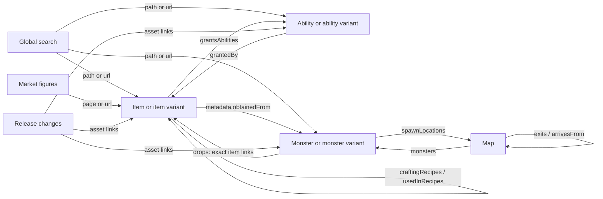

# Vesteria Database: site and API route map

Mapped on **15 November 2026, Asia/Jakarta**. Origin: **https://db.playvesteria.com**.

The site exposes public JSON for all 36 route samples checked. No credentials were needed. A Discord information bot can use these endpoints directly, with the catalog as its local lookup index.

## What was mapped

- Read all **11 sitemaps** advertised by `robots.txt`: **3,087 distinct sitemap URLs**.
- Inspected six public navigation pages and sampled **36 JSON URLs**, all returning HTTP 200 and valid JSON.
- Recorded **2,832 image URLs** from the image sitemap without downloading image files.
- Captured **16 GET operations** from OpenAPI. Additional working routes are documented below.
- Confirmed that `Accept: application/json` returns JSON for `/items/stick` and that a conditional catalog request returns **304 Not Modified**.
- Made 59 sequential requests in the repeatable mapping run. This enumerated public routes; it did **not** fetch and validate every page or try every query combination.

Evidence: [summary](../data/vesteria/summary.json), [request log](../data/vesteria/requests.json), [endpoint checks](../data/vesteria/endpoint-checks.json), [full URL inventory](../data/vesteria/urls.csv).

Catalog build: `7455512f2876fa9e`, built **15 November 2026 at 02:42:20 WIB** (`2026-11-14T19:42:20Z`). These are a snapshot's contents, not a guarantee of live game state.

| Content | Public records observed | Detail pages including variants |
| --- | ---: | ---: |
| Items | 1,453 base items + 863 variations | 2,316 |
| Abilities | 18 books; 174 abilities + 246 visible variations | 438 including books |
| Monsters | 122 base encounters + 89 variations | 211 |
| Maps | 17 | 17 |
| Updates | 23 release pages | 23 |
| Videos | 17 | 17 |
| Guilds | 47 | 47 |
| Codes | 25 active + 10 expired | One index |
| Guides | 17 entries linking to the forum | One index |

The sitemap totals also include index, discovery, and policy pages. Catalog summary counts include some hidden records or group containers: for example, `assets.monsters` has 128 family records, while `/api/monsters` returns 211 public encounters. Use the appropriate result list for counts shown to users.

## URL hierarchy

All paths below are relative to the origin. Braces indicate placeholders, not literal URLs.

```text
/
├── search?q={text}&format=json
├── items
│   └── {item-slug-or-id}
│       ├── ?variation={variation-key}
│       ├── thumbnail[?variation={key}&size=150]
│       └── market-history[?variation={key}&attribute={attribute}]
├── abilities
│   └── {book-slug}
│       └── {ability-slug-or-id}
│           ├── ?variation={variation-slug}
│           └── thumbnail[?size=150]
├── monsters
│   └── {monster-slug}[?variation={variation-key}]
├── maps
│   └── {map-slug}
│       └── key-art.png
├── market
│   └── {item-slug}[?variation={variation-key}]
├── dashboards
│   └── badlands-pvp
├── codes
├── versions
│   └── {release-number}
├── videos
│   └── {video-slug}
├── guides
├── guilds
│   └── {guild-slug}
├── popular
├── recently-updated
├── api
│   ├── catalog
│   ├── items[?search={text}]
│   ├── abilities[?search={text}]
│   ├── monsters[?search={text}&category={category}&page={page}&form={form}]
│   │   └── {monster-slug}[?variation={variation-key}]
│   └── maps
│       └── {map-slug}
├── developers
├── llms.txt
├── openapi.json
├── content-license
├── robots.txt
└── *.xml (sitemaps)
```

The JSON routes in the tables below were sampled. Media routes and guild detail pages were discovered/documented but were not individually requested. The slug-or-ID aliases are documented by the site; probes used slugs.

## JSON routes for the bot

### Catalog, search, and game assets

| Purpose | Request | Response shape observed |
| --- | --- | --- |
| Bulk game data | `/api/catalog` | `build`, `version`, `counts`, `constants`, `assets`, `versions` |
| Search across content | `/search?q={text}&limit=100&format=json` | `query`, `count`, `total`, `truncated`, `results[]` |
| List items | `/api/items` | `count`, `items[]` |
| Search items and variants | `/api/items?search={text}` | `count`, `search`, `filters`, `items[]` |
| Filter items | `/items?format=json&search=tier%3A7%20tag%3Astaff` | Same item-search envelope |
| Item details | `/items/{slug}?format=json` | Direct item object |
| Exact item variant | `/items/{slug}?variation={key}&format=json` | Direct resolved item object, with parent and variation information |
| List ability books | `/api/abilities` or `/abilities?format=json` | `count`, `abilityBooks[]`; each book contains `abilities[]` |
| Search abilities | `/api/abilities?search={text}` | `count`, `filters`, `search`, **`results[]`** |
| Ability book | `/abilities/{book}?format=json` | Direct book object with `abilities[]` |
| Ability | `/abilities/{book}/{ability}?format=json` | Direct ability object with `stats`, `rankTables`, `variations` |
| Exact ability variant | `/abilities/{book}/{ability}?variation={key}&format=json` | Direct variant object including `parent`, `rankTables`, `differences` |
| Flat monster list | `/api/monsters` or `/monsters?format=json` | `count`, `search`, `filters`, `monsters[]` |
| Filter monsters | `/api/monsters?form=variation&page=99` | Same envelope; this sample returned 8 boss variations |
| Monster details | `/api/monsters/{slug}` or `/monsters/{slug}?format=json` | Direct monster object with `drops`, `combatStats`, `spawnLocations` |
| Exact monster variant | `/api/monsters/{slug}?variation={key}` | Direct monster object with `parent`, `variation`, exact drops |
| Map list | `/api/maps` or `/maps?format=json` | `count`, `maps[]` |
| Map details | `/api/maps/{slug}` or `/maps/{slug}?format=json` | Direct map object with `monsters`, `characters`, `exits`, `arrivesFrom`, `viewer` |

Useful verified examples:

- [Magnificent Holy Scroll](https://db.playvesteria.com/items/holy-scroll?variation=magnificent&format=json)
- [Boulder Throw](https://db.playvesteria.com/abilities/adventurer/rock-throw?variation=boulder-throw&format=json)
- [Hobo Bandit](https://db.playvesteria.com/api/monsters/bandit?variation=hobo)
- [Nilgarf](https://db.playvesteria.com/maps/nilgarf?format=json)

There is no `/api/items/{slug}` or `/api/abilities/{book}/{ability}` detail route in the supplied OpenAPI specification. Use the verified page routes with `format=json`; unlisted alternatives were not probed.

### Market and other sections

| Purpose | Request | Response shape observed |
| --- | --- | --- |
| Codes | `/codes?format=json` | `codes[]`, `expiredCodes[]`, `count`, `expiredCount`, `categories` |
| Market rankings | `/market?format=json` | `markets[]`, `count`, `window`, `sort`, `order`, `updatedAt`, `dataSince` |
| Item market figures | `/market/{slug}?format=json` | `last24Hours`, `markets[]`, `updatedAt`, `url` |
| Price history | `/items/{slug}/market-history` | `days[]`, `hours[]`, `attribute`, `trackingSince`, `page` |
| Dashboard directory | `/dashboards?format=json` | `dashboards[]` |
| Badlands PvP | `/dashboards/badlands-pvp?format=json` | `items[]`, `abilityBooks[]`, pagination, sorting, `minFights`, `updatedAt` |
| Update list | `/versions?format=json` | `count`, `versions[]` |
| Update detail | `/versions/{number}?format=json` | `changes[]`, `groups[]`, `notes[]`, `footnotes[]`, release metadata |
| Videos | `/videos?format=json` | `count`, `videos[]` |
| Video detail | `/videos/{slug}?format=json` | Direct video object |
| Player guides | `/guides?format=json` | `count`, `guides[]` |
| Guild directory | `/guilds?format=json` | `count`, `guilds[]`, `feed[]`, `feedPagination`, `demoMode`, `demoReason` |
| Popular pages | `/popular?format=json` | `count`, `pages[]` |
| Recently updated pages | `/recently-updated?format=json` | `count`, `pages[]` |

`guides`, `guilds`, `popular`, and `recently-updated` are observed working JSON responses beyond the 16 OpenAPI operations. Guild detail JSON and guild pagination parameters were not tested. The navigation exposes `/guilds?page=2`.

## Parameters and response differences

| Route family | Relevant parameters | Notes |
| --- | --- | --- |
| Public page JSON | `format=json` | Append with `&` if a query already exists; `/api/` read routes return JSON directly |
| Global search | `q`, `limit` | Guide documents default 8, maximum 100; inspect `truncated` |
| Item search | `search` | Guide documents `tag:`, `tier:`, `class:` tokens; a combined tier/tag query was verified |
| Ability search | `search` | Search returns a flat `results` array; the unfiltered index returns `abilityBooks` |
| Monster search | `search`, `category`, `page`/`book_page`, `form` | `form=base` or `variation`; page is a Monster Book section, not conventional pagination; `99` means bosses |
| Variations | `variation` | Use the selector from the returned link; keys can be words or numbers |
| Market index | `window`, `sort`, `order` | Guide documents `window=24h`/`7d`, `sort=mushcoin`; only defaults sampled |
| Market detail/history | `variation`; history also `attribute` | Attribute filters such as `pristine` are documented, not individually tested |
| PvP dashboard | `category`, `sort`, `order`, `page`; `books_sort`, `books_order`, `books_page` | Gear and ability book rankings have independent controls; only defaults sampled |

Two observed details matter when writing the client:

1. **Global search returns `path`, not `url`, in the tested results.** Use `result.url ?? result.path`, resolve it against the origin, then preserve its query parameters. The guide describes `url`, so support both.
2. **Market averages can be fractional numbers.** The sampled `averagePrice` is a float, despite the guide's general description of currency as raw integers. Keep numeric precision until presentation. Currency units are Mushcoins: 1 Silver = 1,000; 1 Gold = 1,000,000; 1 Platinum = 1,000,000,000.

Other practical distinctions:

- The catalog uses `assets.abilities`; the ability index uses `abilityBooks`.
- `/api/maps` and `/maps?format=json` have the same envelope but differed in payload size. Do not assume aliases have byte-identical fields.
- The latest release page was `/versions/1358`, covering versions **1358–1359**. Follow the supplied `url` instead of constructing one from the largest release number.
- Price-history responses already contain JSON without `format=json`.
- `/popular?format=json` returned 2,947 records; it is broader than the homepage's short popular list.

## Links between data types



These links support item sources, drop lookup, crafting, skill descriptions, and spawn lookup without scraping text from HTML. Some links or lists are absent: in the Nilgarf sample, several exits had a name but `url: null`. Preserve such entries without inventing a destination page. `characters` supplies NPC names, roles, and some shop names; no standalone NPC or quest route was discovered in these sources.

Image fields include `thumbnailUrl`, `imageUrl`, and map `keyArtUrl`. Resolve relative image URLs against the origin and use the record's actual URL. Sitemap media paths are inventoried separately in [image-urls.json](../data/vesteria/image-urls.json).

## Suggested first bot integration

1. Download `/api/catalog` on startup, storing `build.id`, `build.builtAt`, and the HTTP `ETag`.
2. Index visible item names and variants, books and their abilities, public monster encounters, and map summaries. Skip `hidden` records and avoid presenting `groupOnly` monster families as encounters.
3. Resolve a command's input locally or with global search. If multiple entries match, let the user select the exact entry.
4. Fetch the selected detail URL as JSON. Variant summaries in the catalog do not replace a resolved variant response.
5. Format an embed with the exact page link, its supplied thumbnail, and the requested facts. Interpret structured `metadata` according to its `kind`; retain labels and units.
6. Revalidate the catalog with `If-None-Match`. Cache market responses separately; the guide describes approximately 15-minute refreshes for 24-hour figures and hourly refreshes for longer windows/history.

| Candidate command | Data source |
| --- | --- |
| `/item <name>` | Item search → exact item JSON |
| `/ability <name>` | Ability search → book/ability JSON |
| `/monster <name>` | Monster search → exact monster JSON |
| `/drops <monster>` | Monster `drops` |
| `/where <item>` | Item `metadata.obtainedFrom` → linked monsters → `spawnLocations` |
| `/map <name>` | Map detail JSON |
| `/price <item>` | Market detail + optional price history |
| `/codes` | Codes index |
| `/updates` | Version index → returned release URL |

Exact variation identity should be part of cache keys. For drop calculations, retain conditions and distinguish chance, quantity, and roll count. For price comparisons, keep history entries marked `legacy: true` separate from current per-item figures. These details affect answers even when the URL lookup is correct.

## Crawl scope and sources

The mapper obeyed `robots.txt`. It recorded links to `/login` and `/videos/submit` from navigation but did not fetch them. It did not request comments, tracking/watch links, moderation routes, or account data. Community and guild indexes were sampled for route discovery; game-data commands can be implemented without them.

The site's license explicitly includes Vesteria Discord bots among its examples. Player-supplied content is outside its covered game content; see the [Content License](https://db.playvesteria.com/content-license) for the source's terms.

Primary discovery documents:

- [Developer guide](https://db.playvesteria.com/developers)
- [Plain-text API guide](https://db.playvesteria.com/llms.txt)
- [OpenAPI specification](https://db.playvesteria.com/openapi.json)
- [Robots policy and sitemap list](https://db.playvesteria.com/robots.txt)
- [Canonical sitemap](https://db.playvesteria.com/sitemap.xml)
- [Public catalog](https://db.playvesteria.com/api/catalog)

The checked HTTP status and response keys are observations from this run. Parameter options explicitly labeled as documented were read from the site's guide/specification and were not exhaustively tested. The inventory describes the discoverable public surface, not the server's entire internal routing table.
